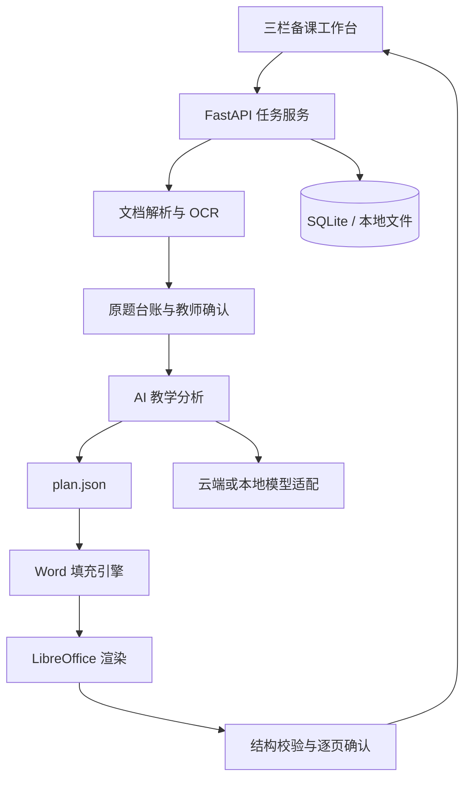

# 技术架构与数据设计（拟定）

## 技术栈

| 层 | 技术 |
|---|---|
| 前端 | Vue 3 / TypeScript / Vite / Pinia / Element Plus |
| 预览 | PDF.js，使用真实渲染结果 |
| API | FastAPI + Python |
| 解析 | pypdfium2 或现有 PyMuPDF（核查商业授权），PaddleOCR/MinerU |
| 模型 | OpenAI-compatible SDK + provider adapter，结构化 JSON |
| Word | python-docx + 原固定模板；LibreOffice 转 PDF |
| 数据 | SQLite + 本地文件；后续 PostgreSQL、对象存储 |
| 分发 | 本地 Web，后续 Tauri 桌面 / 云端 |

## 核心数据协议

沿用 V1.0 的 schema_version=1：metadata 为教学信息，source_questions 为独立题目 ID、来源与考点，pages 为 first/middle/last 页型及 blocks（paragraph/table/image），每个原题 ID 在输出绑定一次。新增应用层记录资料文件、页码与 bbox、原始转写、教师修正、确认状态、知识点、版本、模型运行日志。先保留兼容 V1 的 plan.json，再设计扩展字段；不让模型直接生成任意 OOXML 或可执行代码。

## 服务拆分（建议接口，尚未开发）

- POST /api/materials：上传资料并记录文件类型及校验值。
- POST /api/jobs/parse：识别页面及题目；GET /api/jobs/{id} 查询进度。
- PATCH /api/questions/{id}：教师确认或修正原题。
- POST /api/lessons：新建教案；POST /api/lessons/{id}/generate 生成教学内容。
- POST /api/lessons/{id}/render：填充、转 PDF、校验；下载 DOCX。
- POST /api/models/test：测试连通性及模型能力，不返回密钥。

## 复用清单

SKILL.md 和 references 作为约束与 prompt；fill_template.py 负责固定模板页型复制；validate_docx.py 负责外表属性、受保护内容、文字、ID、页数等结构检查；render_preview.py 负责逐页预览；extract_material.py 负责文件解析辅助。脚本已在历史包中生成，尚待仓库完整同步。不要假定脚本自动完成 OCR 或自动决定分页；由 AI/应用编排并根据结果调整。

## 关键技术设计

- 文本层优先；扫描件用 OCR，低置信区域用视觉模型补充，再人工确认；相同原文件可缓存解析结果。
- 固定模板先采用三页型复制、可编辑白名单及显式分页；表格不可随意重绘。分页超限移动完整题块并重渲染，不删题或缩纸张。
- 模型输出按 schema 校验，失败可重试并限流。原题台账与教学创作分离，模型不得在创作阶段改写已确认原题。
- 本地服务限制监听范围，密钥存系统凭据或安全后端，不写进前端/日志/Git；用户自定义模型地址需防 SSRF，上传文件检查格式与体积，转换进程设超时和独立临时目录，不运行宏。
- 记录来源、模型、token、用时、错误与重试次数；使用最小必要教学数据。
- 结构验收自动化 + 实际逐页查看 + 原题复核。不同 Word/WPS/LibreOffice 字体与分页差异需要实测。

## 风险排序

高：原题/划线/空白保真，跨页题目、固定外框、自动分页；中高：复杂数学公式及图形、许可证、隐私；中：模型接口差异与成本；中低：常规前端开发。先攻克高风险，不先做复杂 UI。
